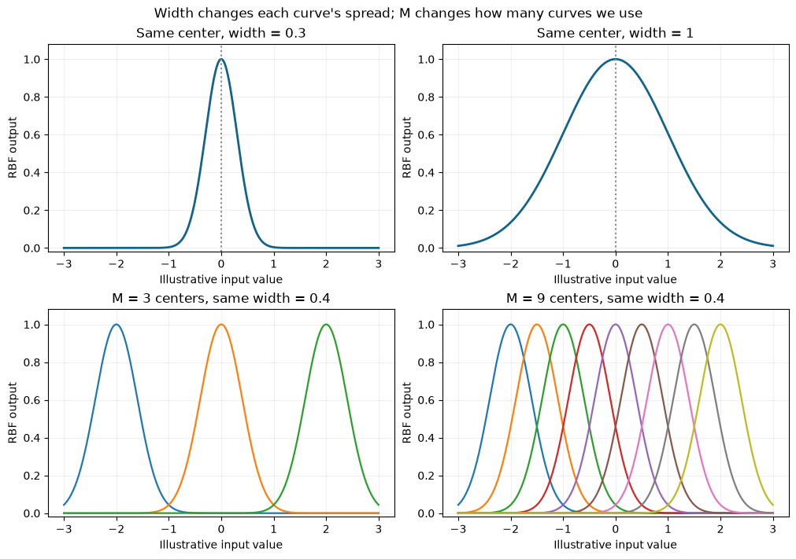
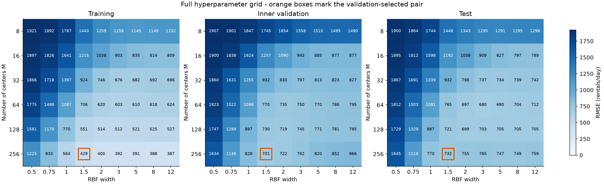

# Machine Learning · SBU

**M.Sc. Computer Science · Shahid Beheshti University**  
Coursework by **[Amirhossein Mahmoudi](https://github.com/ammahmoudi)** · Instructor: **Dr. Ali Katanforosh**

[](https://github.com/ammahmoudi/machine-learning-sbu/actions/workflows/checks.yml)


Assignments, notebooks, mathematical derivations, and experiments from my graduate Machine Learning course. The implementations build the basis functions, preprocessing, losses, and evaluation directly, using NumPy's permitted least-squares solver for offline training.

**[Open Homework 1](assignments/hw01-linear-regression/assignment1.ipynb)** · **[Experiment results](assignments/hw01-linear-regression/results/hyperparameter_grid.csv)** · **[Dataset catalog](data/README.md)**



## Coursework

| Assignment | Topics | Status |
| --- | --- | --- |
| [01 · Linear regression](assignments/hw01-linear-regression/README.md) | Gaussian RBFs, design matrices, least squares, RMSE, hyperparameter search | Complete · [executed notebook](assignments/hw01-linear-regression/assignment1.ipynb) |
| [02 · Regularized regression](assignments/hw02-regularized-linear-regression/README.md) | Ridge, Lasso, closed-form solutions, GD, SGD, sparsity | Planned |

## Homework 1: predicting daily bike rentals

The [UCI Bike Sharing dataset](https://archive.ics.uci.edu/dataset/275/bike+sharing+dataset) provides 731 daily observations. Nine source predictors become 21 numerical inputs, then Gaussian RBF features. A fixed split assigns 584 days to training and 147 to testing; a training-only validation subset selects hyperparameters.

- **Width study:** nine widths with 64 centers.
- **Center-count study:** 8, 16, 32, 64, 128, and 256 centers at fixed width.
- **Full grid:** all **54 combinations**, with shared splits, scaling, and reproducible center samples.
- **Implementation:** manual category encoding, scaling, basis evaluation, SSE, and RMSE; pandas for data loading and tables, Matplotlib for figures.



The outlined pair is selected by **validation error**, then refitted on the outer training set:

| Selected setting | Training RMSE | Validation RMSE | Test RMSE |
| --- | ---: | ---: | ---: |
| M = 256, width = 1.5 | 429.42 | 700.78 | 731.94 |

Errors are in rentals/day. The constant training-mean baseline has test RMSE **1910.15**. The larger grid improves validation error but does not improve test error over the sequential selection. These experiments evaluate a random split within 2011–2012; they do not establish future forecasting accuracy.

The [notebook](assignments/hw01-linear-regression/assignment1.ipynb) includes the data description, derivations, code, tables, six figures, and conclusions. Saved [metrics](assignments/hw01-linear-regression/results/hyperparameter_grid.csv), [split assignments](assignments/hw01-linear-regression/results/split.csv), and [metadata](assignments/hw01-linear-regression/results/metadata.json) make the experiments reproducible.

## Run locally

Install [uv](https://docs.astral.sh/uv/getting-started/installation/), then:

```bash
git clone https://github.com/ammahmoudi/machine-learning-sbu.git
cd machine-learning-sbu
uv sync --locked --group notebook
uv run --locked python assignments/hw01-linear-regression/download_data.py
```

Open [assignment1.ipynb](assignments/hw01-linear-regression/assignment1.ipynb) in VS Code or a Jupyter-compatible editor, select the project's `.venv` Python kernel, and run all cells. The checked-in notebook already contains executed outputs for reading on GitHub.

To reproduce the script results and run the nine checks:

```bash
uv run --locked python assignments/hw01-linear-regression/regression.py
uv run --locked python -m unittest discover -s assignments/hw01-linear-regression -p test_regression.py -v
```

To execute and save the notebook programmatically:

```bash
uv run --locked --group notebook python assignments/hw01-linear-regression/execute_notebook.py
```

Dependencies are declared in [pyproject.toml](pyproject.toml) and resolved in [uv.lock](uv.lock). The downloader verifies the source archive's SHA-256 and preserves the original data. After installation and download, experiments can run offline with `uv run --locked --offline`.

## Repository layout

```text
assignments/
  hw01-linear-regression/              # Notebook, scripts, tests, and results
  hw02-regularized-linear-regression/  # Assignment requirements and plan
data/                                 # Dataset catalog; downloads stay local
notes/                                # Course notes
references/                           # Textbook bibliography
pyproject.toml                        # uv project and dependencies
uv.lock                               # Locked environment
```

Textbook and instructor PDFs, raw datasets, local environments, and submission ZIPs are excluded from version control. All existing local course materials are preserved.

## Data and references

- Fanaee-T, H. (2013). *Bike Sharing*. UCI Machine Learning Repository. [doi:10.24432/C5W894](https://doi.org/10.24432/C5W894). UCI lists the dataset under CC BY 4.0.
- Fanaee-T, H. and Gama, J. (2013). *Event labeling combining ensemble detectors and background knowledge*. [doi:10.1007/s13748-013-0040-3](https://doi.org/10.1007/s13748-013-0040-3).
- Bishop, C. M. (2006). *Pattern Recognition and Machine Learning*. Springer. See [references](references/README.md).

The coursework is organized around the instructor's assignment requirements. Third-party materials retain their respective rights and attribution requirements.
