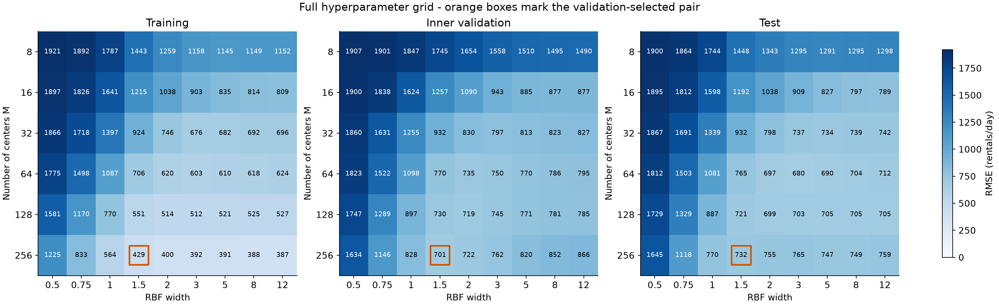
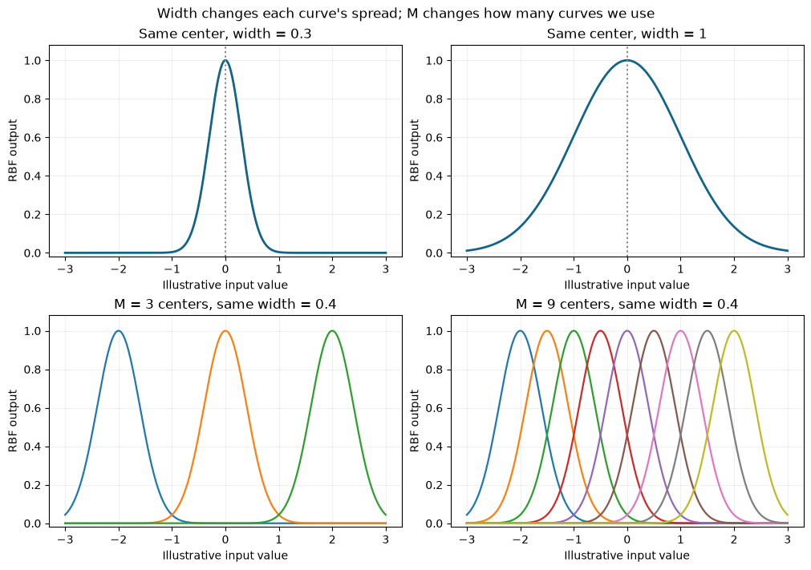

# Homework 1 · Linear Regression

**Status:** complete · **Dataset:** UCI Bike Sharing · **Method:** Gaussian RBFs and offline least squares

[← Course overview](../../README.md) · **[Open the executed notebook](assignment1.ipynb)** · [Source code](regression.py) · [HTML report](results/report.html)

## Overview

The [UCI Bike Sharing dataset](https://archive.ics.uci.edu/dataset/275/bike+sharing+dataset) provides 731 daily observations. Nine source predictors become 21 numerical inputs, then Gaussian RBF features. A fixed split assigns 584 days to training and 147 to testing; a training-only validation subset selects hyperparameters.

- **Width study:** nine widths with 64 centers.
- **Center-count study:** 8, 16, 32, 64, 128, and 256 centers at fixed width.
- **Full grid:** all **54 combinations**, with shared splits, scaling, and reproducible center samples.
- **Implementation:** manual category encoding, scaling, basis evaluation, SSE, and RMSE; pandas for data loading and tables, Matplotlib for figures.



The outlined pair is selected by **validation error**, then refitted on the outer training set:

| Selected setting | Training RMSE | Validation RMSE | Test RMSE |
| --- | ---: | ---: | ---: |
| M = 256, width = 1.5 | 429.42 | 700.78 | 731.94 |

Errors are in rentals/day. The constant training-mean baseline has test RMSE **1910.15**. The larger grid improves validation error but does not improve test error over the sequential selection. These experiments evaluate a random split within 2011–2012; they do not establish future forecasting accuracy.

The [notebook](assignment1.ipynb) includes the data description, derivations, code, tables, six figures, and conclusions. Saved [metrics](results/hyperparameter_grid.csv), [split assignments](results/split.csv), and [metadata](results/metadata.json) make the experiments reproducible.


## Understanding the basis functions



Width controls the spread of each Gaussian; M controls how many centers supply basis functions. The notebook also includes an [activation heatmap](results/rbf_features.png) showing the actual RBF outputs for 30 test days.

## Comparing the studies

| Study | Validation-selected setting | Training RMSE | Validation RMSE | Test RMSE |
| --- | --- | ---: | ---: | ---: |
| Width sweep | M = 64, width = 2.0 | 620.31 | 734.80 | 697.09 |
| Sequential center-count sweep | M = 128, width = 2.0 | 514.28 | 718.93 | 699.28 |
| Full grid | M = 256, width = 1.5 | 429.42 | 700.78 | 731.94 |

All errors are in rentals/day. The final setting is chosen by validation RMSE. The lower descriptive test error at M = 64 and width = 3.0 (679.55) is reported in the notebook and is not used for selection.

[metadata.json](results/metadata.json) records the width study at top level, the sequential count study under `center_count_study`, and the complete grid under `grid_search`. `final_model` identifies [grid_model.npz](results/grid_model.npz). The other saved models retain the earlier studies.

## Deliverables and execution


- [Executed Jupyter Notebook](assignment1.ipynb): dataset description, equations, model code, experiments, tables, six plots, and a concise discussion. It reads the original daily CSV from the shared data folder.
- Pandas loads the CSV and displays the data preview and results tables. Basis functions, category encoding, scaling, SSE, RMSE, and the regression implementation remain manual.
- Local submission ZIP (excluded from version control): report, source code, original brief, data/provenance, saved results, and uv project/lock files. Extract it and follow `START_HERE.txt`.
- [Complete report](results/report.html): dataset preview and provenance, feature definitions, mathematical derivation, experimental tables/plots, analysis, full regression implementation, and run instructions. The HTML embeds its plots and can be read offline.
- [Regression implementation](regression.py): manually implemented basis functions, design matrix, preprocessing, SSE, and RMSE; offline training through the permitted NumPy least-squares solver.
- [Download script](download_data.py): verifies the exact UCI archive and preserves original files.
- [Mathematical and data checks](test_regression.py): nine tests covering the basis, metrics, synthetic weight recovery, scaling, splits, leakage exclusions, and least-squares stationarity.
- [Metrics](results/metrics.csv), [test predictions](results/test_predictions.csv), [split assignments](results/split.csv), [experiment metadata](results/metadata.json), and [saved model](results/model.npz).
- [RBF illustration](results/rbf_intuition.png): how width and M affect Gaussian basis functions. [Actual RBF features](results/rbf_features.png): 30 test days by 256 centers.
- [Width RMSE plot](results/rmse_vs_width.png), [center-count RMSE plot](results/rmse_vs_centers.png), and [width-study prediction plot](results/test_predictions.png).
- [Full-grid metrics](results/hyperparameter_grid.csv), [train/validation/test heatmaps](results/hyperparameter_grid.png), [final selected grid model](results/grid_model.npz), and [its test predictions](results/grid_test_predictions.csv).
- [Center-count metrics](results/center_count_metrics.csv) and [center-count selected model](results/center_count_model.npz). The original saved model is retained for the width study.

Install [uv](https://docs.astral.sh/uv/getting-started/installation/). If needed, clone the course repository first:

```bash
git clone https://github.com/ammahmoudi/machine-learning-sbu.git
cd machine-learning-sbu
```

Use uv from the workspace root (Python 3.13 is selected by the workspace version file):

```powershell
uv sync --locked
uv run --locked python assignments/hw01-linear-regression/download_data.py
uv run --locked python assignments/hw01-linear-regression/regression.py
uv run --locked python -m unittest discover -s assignments/hw01-linear-regression -p test_regression.py
```

Dependencies are declared in [pyproject.toml](../../pyproject.toml), with exact resolved versions and hashes in [uv.lock](../../uv.lock). uv manages the local environment; no activation command is needed. No high-level ML framework is installed or used. After downloading dependencies and data, the experiment can also run with `uv run --locked --offline`.

### Using the notebook

Run `uv sync --locked --group notebook`, open [assignment1.ipynb](assignment1.ipynb) in VS Code, select the workspace `.venv` Python interpreter as the kernel, and choose **Run All**. The notebook already contains executed outputs, so it can also be read without running it. Its 29 code cells were successfully executed and reproduce the original results. Keep the project folders together so the notebook can read the CSV; there is no encoded dataset block.

To regenerate and execute the notebook programmatically:

```powershell
uv run --locked --group notebook python assignments/hw01-linear-regression/build_notebook.py
uv run --locked --group notebook python assignments/hw01-linear-regression/execute_notebook.py
```

The notebook separates CSV loading, data checks, numerical inputs, category encoding, target selection, basis functions, splitting, scaling, center selection, training, and evaluation. Columns are renamed immediately after loading (for example, `temp` to `temperature` and `cnt` to `total_rentals`), and the readable names are used throughout the notebook. Section headings keep the steps separate; explanatory notes focus on modeling choices and mathematics. The combined `load_data` wrapper remains available to the command-line script.

The [builder](build_notebook.py) copies core functions and experiment logic from the verified script and uses normal CSV loading. Building clears existing outputs; the [executor](execute_notebook.py) runs every cell, validates the notebook, and saves the executed outputs and plots.


## Dataset attribution

- Fanaee-T, H. (2013). *Bike Sharing*. UCI Machine Learning Repository. [doi:10.24432/C5W894](https://doi.org/10.24432/C5W894). UCI lists the dataset under CC BY 4.0.
- Fanaee-T, H. and Gama, J. (2013). *Event labeling combining ensemble detectors and background knowledge*. [doi:10.1007/s13748-013-0040-3](https://doi.org/10.1007/s13748-013-0040-3).

## Assignment requirements

<details>
<summary>Original requirements and completion checklist</summary>

Source of requirements: the instructor-provided *Linear Regression - Programming Assignment - Part 1* PDF, retained locally and excluded from the public repository. The original brief takes precedence over this checklist.

## Implementation checklist

- [x] Select one dataset from the [suggested catalog](../../data/README.md).
- [x] Define the features and regression target, and document preprocessing.
- [x] Choose a basis family controlled by at least one hyperparameter, such as polynomial degree or RBF width/number of centers.
- [x] Choose offline least squares or online SGD (sequential or mini-batch).
- [x] Implement separate functions for basis evaluation and sum of squared errors (SSE).
- [x] Implement the design matrix for offline learning or the error gradient for online learning.
- [x] Split approximately 80% training / 20% testing and record the split.
- [x] Compute training and test RMSE separately.
- [x] Vary the basis hyperparameter and plot both training and test RMSE against it.

## Submission checklist

- [x] Introduce the dataset, show its first rows, and explain every selected feature and the target.
- [x] Describe who collected the data, how and why, and which subjects or objects it represents; cite the original sources.
- [x] Explain the mathematical formulation and any derivations developed for the assignment.
- [x] Include all source code and package installation/execution instructions.
- [x] Present experiment tables/plots, analysis, and conclusions.

The brief permits a single organized Jupyter Notebook containing the deliverables, or a publicly accessible cloud link to the complete deliverables.

## Implementation constraints

The brief strongly encourages avoiding high-level ML libraries and deep learning frameworks. Library functions are explicitly permitted for solving linear systems, matrix inversion, and least-squares problems. Basis functions, error calculations, gradients, and the learning procedure must be implemented by the student. Basic vector and matrix operations are permitted.

Keep the dataset, preprocessing decisions, and basis implementation reusable for [homework 2](../hw02-regularized-linear-regression/README.md).

</details>
